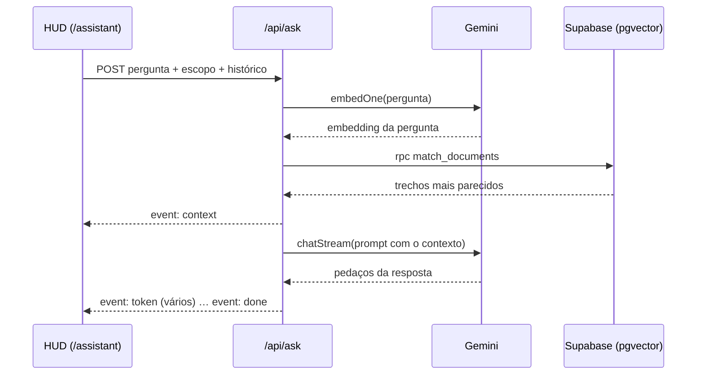

# Beyond Bits — assistente pessoal (HUD + cérebro RAG)

App Next.js que responde perguntas sobre seus dados do **Trello** e do **Beyond Brain**,
com uma interface HUD (estilo J.A.R.V.I.S.) ligada ao streaming real do Gemini.

> Fases 1–3 (cérebro/RAG) + interface (HUD ligado ao `/api/ask`). Voz (a assistente se chama "Lisa") é a Fase 4.

---

## ⚠️ Segurança — leia antes de subir pro GitHub

- O arquivo **`.env` contém segredos** (Gemini, Supabase *service_role*, Trello). Ele **já está no `.gitignore`** — **não** o remova de lá e **não** o commite.
- A **`SUPABASE_SERVICE_ROLE_KEY` é a chave-mestra do banco** (ignora RLS). Ela só é usada no **servidor** (`src/lib/supabase.js`, rotas de API e scripts). **Nunca** a coloque em código de cliente nem em variável `NEXT_PUBLIC_*`.
- Suas chaves apareceram em prints/arquivos compartilhados. O ideal é **regenerá-las** antes de usar em produção: Gemini (AI Studio → nova chave), Trello (`trello.com/app-key` → revogar token), Supabase (Settings → API → roll da service key). Depois é só atualizar o `.env` e as variáveis na Vercel.

---

## 1. Instalar

```bash
npm install
```

## 2. Criar o schema no Supabase

Abra o **SQL Editor** do projeto do Beyond Brain (`wcwikmszduuqlytikjwq`), cole o conteúdo de
`db/schema.sql` e rode. Isso ativa o `pgvector`, cria a tabela `documents` e a função `match_documents`.

## 3. Indexar seus dados

```bash
npm run ingest
```

Puxa os 4 boards do Trello + suas notas do Beyond Brain, gera embeddings (768d) e grava no banco.

## 4. Testar o cérebro por texto (sem interface)

```bash
npm run ask "quais clientes do CRM estão em negociação?"
```

Se responder com base nos seus dados, o cérebro está validado.

## 5. Rodar a interface (HUD)

```bash
npm run dev
```

Acesse `http://localhost:3000`. Digite uma pergunta na barra inferior e tecle **Enter**:
os cards da direita são preenchidos pelo RAG real e a resposta aparece em streaming no centro.

---

## Deploy na Vercel

1. Suba o repositório no GitHub (o `.env` **não** vai junto — é o esperado).
2. Na Vercel: **New Project** → importe o repo.
3. **Settings → Environment Variables**: cole **cada variável do `.env`** (mesmos nomes e valores).
   As variáveis de `db/schema.sql` continuam no Supabase; aqui vão só as do `.env`.
4. Deploy. A Vercel injeta as variáveis no servidor — as chaves nunca chegam ao navegador.

> A ingestão (`npm run ingest`) roda no seu terminal ou num cron; a Vercel serve a interface e a API.

---

## Duas fontes de dado bem diferentes: tela (ao vivo) × Assistente (embeddings)

O app tem duas operações que dependem do Trello de jeitos diferentes, e é importante não
confundir uma com a outra:

- **Tela** (Kanban, Boards, Dashboard, Tarefas) e **notificações push** (card novo, tarefa
  atrasada) — leem o Trello **direto e ao vivo** (`src/lib/liveTrello.js` → `loadTrello()`),
  sem passar pelo Supabase nem pelo Gemini. Sempre atual, sem depender do SYNC. O
  **↻ ATUALIZAR** de cada painel só dispara essa leitura ao vivo (rápida, sem custo de API) —
  e cada um desses painéis também se atualiza sozinho a cada 1 min.
- **Assistente** (busca semântica livre, tipo "quais tarefas tenho relacionadas a X") —
  essa sim depende de embeddings gerados pelo Gemini, gravados em `public.documents`
  (Supabase) pelo **◈ SYNC**. Perguntas por board específico ou por prazo ("tarefas de hoje",
  "cards do CRM") também já são ao vivo — só a busca semântica livre, sem filtro, é que
  precisa do índice do SYNC.

## SYNC — como funciona, e como automatizar de hora em hora

O botão **◈ SYNC** (Topbar, aparece em toda aba) é o jeito de manter o índice semântico do
Assistente em dia: ele lê o Trello + Beyond Brain, gera embeddings (Gemini) e grava em
`public.documents` (Supabase).

Como o plano Hobby da Vercel limita funções a 60s e o Gemini tem cota de embeddings por
minuto, uma sincronização completa é fatiada em várias chamadas pequenas a `/api/ingest`
(≤20 chunks por chamada) — é por isso que o SYNC "demora" e mostra progresso nos logs, em vez
de ser instantâneo.

**Pra rodar isso (e as notificações push) automaticamente, sem precisar clicar em nada:**

1. Rode `db/schema.sql` (se ainda não rodou) — cria `public.sync_progress`, que guarda o
   progresso do ciclo automático.
2. Rode `db/cron.sql` no SQL Editor do Supabase, depois de trocar os placeholders (domínio +
   `INGEST_SECRET` + `CRON_SECRET`) pelos valores reais. Isso agenda, via `pg_cron` + `pg_net`
   (extensões nativas do Supabase, sem custo extra):
   - **SYNC** — a cada hora (minuto 0) reinicia o ciclo, e a cada 2 min avança uma fatia
     (`/api/cron/sync`) — sem custo quando não há ciclo em andamento. 2 em 2 min, não 1 em 1,
     de propósito: cada fatia chama o Gemini pra gerar embeddings, e isso disputa cota com o
     chat/voz do Assistente — mais devagar sobra mais cota pro uso interativo;
   - **Notificações** — a cada 5 min chama `/api/cron/notify` (chamado novo/reaberto, SLA
     estourando, tarefa atrasada).

O progresso do SYNC mora inteiro no Postgres (`public.sync_progress`, linha única) — a Vercel
não precisa ficar "acordada" entre os ticks, e reiniciar o deploy não perde o lugar onde parou.
O Topbar mostra um indicador **AUTO-SYNC** com a última execução (passe o mouse pra detalhes).

⚠️ **Por que isso não está em `vercel.json`:** o plano Hobby da Vercel só permite cron nativo
**1x por dia** — um cron mais frequente que isso **falha o deploy inteiro** (foi o que aconteceu:
o `/api/cron/notify` ficou configurado pra rodar a cada 5 min em `vercel.json`, e isso quebrou
todo deploy subsequente por dias, sem sintoma óbvio além do "X" nos checks do GitHub). Por isso
os dois crons agora são agendados pelo **Supabase** (que não tem esse limite), e `vercel.json`
ficou vazio — as rotas continuam sendo funções normais da Vercel, só não são mais "cron jobs"
aos olhos dela.

---

## Cota do Gemini — várias chaves com troca automática

O plano gratuito do Gemini tem limite por minuto **e** por dia — com o SYNC automático rodando
o dia inteiro em segundo plano mais o uso normal do Assistente, é fácil esbarrar nisso.

Pra aliviar, o app aceita **mais de uma API key**, testando na ordem e trocando pra próxima
automaticamente quando uma bate no limite de cota (não troca por outros tipos de erro):

```
GEMINI_API_KEYS=chave-do-projeto-1,chave-do-projeto-2,chave-do-projeto-3
```

Defina essa variável (em vez de `GEMINI_API_KEY`) na Vercel e no `.env`, separando as chaves por
vírgula. **Cada chave precisa vir de um projeto diferente** no Google Cloud/AI Studio — chaves do
mesmo projeto compartilham a mesma cota, então usar várias delas não ajuda em nada. Dá pra criar
vários projetos na mesma conta Google (não precisa de contas separadas), gerando uma API key nova
em cada um.

Sem `GEMINI_API_KEYS`, o app continua funcionando normalmente só com `GEMINI_API_KEY` (uma chave).

---

## Map of Deploy — onde cada aplicação está hospedada, e se está no ar

O **mapa** é um quadro do Trello, e continua sendo: a **coluna** é o servidor de hospedagem
(CloudFlare, GitHub Pages, Vercel…), a **etiqueta** do card é a conta em que a hospedagem está, o
**nome** do card é a aplicação e a **descrição** carrega o link. O painel lê esse quadro e
acrescenta o que o Trello não sabe: se a aplicação respondeu.

Duplicar o mapa no banco criaria duas verdades — por isso o Supabase guarda só o histórico de
checagens (`deploy_checks`, item 28 do `db/schema.sql`).

Pra ligar:

1. **`TRELLO_DEPLOY_BOARD_ID`** (opcional): o id ou o código curto do quadro. Sem ela, usa
   `jrz8oesi`, que é o quadro "Map Of Deploy". Usa as mesmas `TRELLO_KEY`/`TRELLO_TOKEN` do resto.
2. **Criar a tabela** `deploy_checks` no Supabase (`db/schema.sql`). Sem ela o mapa ainda aparece,
   só sem uptime nem contagem de quedas — e o painel avisa isso na tela.
3. **Agendar `/api/cron/deploy-check`** na Vercel (Settings → Cron Jobs), de 5 em 5 ou de 15 em 15
   minutos. É o tique que constrói o histórico: sem ele existe o estado do instante em que você
   abriu a tela, e mais nada. Com `CRON_SECRET` definida, a Vercel manda o Bearer sozinha.

No painel, **"quedas" conta episódios, não checagens**: três horas fora com checagem de 5 em 5
minutos é *uma* queda, não trinta e seis. Clicar num card abre a pré-visualização do deploy num
iframe — boa parte das hospedagens recusa ser embutida (`X-Frame-Options`), e nesse caso o painel
diz isso em vez de mostrar um quadrado em branco.

`npm run deploy-map` confere a leitura do quadro e a matemática de disponibilidade sem precisar do
Trello nem do Supabase de pé.

## Dashboard em AR (WebXR)

Em `/dashboard/ar` (botão "◫ MODO AR" no Dashboard normal): aponta a câmera do celular pra
uma parede ou mesa, toca na tela pra fixar ali um painel com os mesmos gráficos do Dashboard
(cards por board, carga por board, tendência do Sentinela), que fica ancorado no espaço
enquanto você anda pela sala.

- **Só funciona no Chrome/Android com suporte a ARCore** — usa a API WebXR
  (`navigator.xr`, sessão `immersive-ar` + `hit-test`). **Safari/iOS não suporta WebXR
  immersive-ar** (só existiria via app nativo com ARKit); no iPhone a página mostra um aviso
  explicando isso em vez de tentar simular AR de qualquer jeito.
- O painel não é o componente React de sempre renderizado como HTML — é desenhado direto em
  Canvas 2D (`src/lib/arCanvasCharts.js`, mesma paleta de `src/lib/chartPalette.js`) e aplicado
  como textura numa malha 3D via `three.js`, porque uma textura WebGL não pode vir de SVG/HTML
  sem risco de "contaminar" o canvas.
- Os dados são as mesmas fontes ao vivo do Dashboard normal (Trello/Sentinela direto, sem
  SYNC/embeddings), atualizando sozinho a cada 45s enquanto a sessão AR estiver aberta.
- **Reconhecimento de tela (opcional):** o MODO TV do Dashboard mostra um QR discreto no
  canto (`src/components/panels/TvArMarker.js`). No modo AR, o botão "🔍 ESCANEAR TELA" abre
  uma pré-visualização de câmera comum (sem WebXR ainda) que procura esse QR via
  `BarcodeDetector` — API nativa do Chrome/Android. O WebXR não dá acesso a pixel bruto de
  câmera pra "reconhecer a tela só de olhar" (bloqueado por privacidade), então o QR é o que
  torna isso confiável. Ao achar, já reage na hora com uns KPIs "3D" flutuando sobre o próprio
  preview (`src/lib/qrPseudo3d.js`, canvas puro, sem engine 3D) — só depois, se quiser, entra
  em AR de verdade pra fixar o painel completo no espaço.
- Fixação com preview ao vivo: o painel aparece semitransparente seguindo a mira em tempo
  real ANTES de fixar (não é "tocar e já cravar às cegas"). Depois de fixado, ajusta com
  gestos — arrastar (1 dedo), redimensionar e girar (2 dedos) — sem depender de acertar o
  hit-test de novo.

## Modo Observância (câmera) e Modo Tela

Dois toggles no Assistente que tornam a conversa multimodal (mesmo modelo de chat,
`gemini-2.5-flash`, também enxerga imagem — sem endpoint/modelo separado):

- **👁 Observância** (câmera, desktop + mobile): liga a câmera frontal; cada pergunta manda
  um retrato do instante junto pro Gemini responder (postura, roupa, gesto, expressão).
- **🖵 Tela** (`getDisplayMedia`, desktop-only — "enquanto mexo no PC"): mesma ideia, mas a
  imagem é uma captura de tela. Tem um sub-modo **💬 AUTO**: vigia sozinha a cada 4 min
  (`/api/screen-comment`) e só fala alguma coisa quando o Gemini decide que há algo
  genuinamente digno de nota — na maioria das vezes fica em silêncio. Fala com a voz do
  NAVEGADOR (não a do Gemini) de propósito, pra não competir por cota de TTS com a conversa
  principal nem interromper uma resposta em andamento.

Nenhuma das duas fica ligada sozinha entre recarregamentos (sem localStorage, de propósito —
é câmera/tela, cada sessão pede de novo) e nenhuma foto é salva em lugar nenhum, nem local
nem no Supabase — só trafega pro Gemini na hora e é descartada.

## Estrutura

```
beyond-bits/
├─ .env                 # SEGREDOS (gitignored)
├─ .env.example         # modelo sem segredos (versionado)
├─ vercel.json          # vazio de propósito — crons vivem no Supabase, não aqui (ver db/cron.sql)
├─ db/
│  ├─ schema.sql        # pgvector + documents + match_documents + sync_progress
│  └─ cron.sql          # agenda SYNC (1x/hora) e notificações (1x/5min) via pg_cron + pg_net
├─ src/
│  ├─ lib/
│  │  ├─ supabase.js    # cliente service_role (SERVER-ONLY)
│  │  ├─ gemini.js      # embeddings + chat streaming
│  │  ├─ rag.js         # busca + prompt + persona (Lisa)
│  │  ├─ sync.js         # loop do botão SYNC manual (navegador)
│  │  └─ ingest/{chunk,trello,brain,runSlice}.js  # runSlice = 1 fatia, usado pelo manual E pelo cron
│  └─ app/
│     ├─ layout.js
│     ├─ page.js        # HUD (interface) ligado ao /api/ask
│     ├─ globals.css
│     └─ api/
│        ├─ ask/route.js         # SSE: context/token/done
│        ├─ ingest/route.js      # 1 fatia de reindexação (botão SYNC manual)
│        ├─ sync-status/route.js # status do SYNC automático (indicador AUTO-SYNC no Topbar)
│        ├─ cron/sync/route.js   # 1 fatia de reindexação (tick automático — Supabase pg_cron)
│        ├─ cron/notify/route.js # notificações push (tick automático — Supabase pg_cron)
│        └─ health/route.js      # bolinhas de conexão
└─ scripts/{ingest,ask}.mjs
```

## Mapeamento das rotas

Esta seção mapeia como o projeto se organiza no Next.js: as rotas (telas e endpoints), os
componentes que elas carregam e o caminho que uma pergunta percorre — da interface ao servidor,
passando pelo RAG no Supabase, até a resposta da Lisa chegar em tempo real.

O projeto usa o **App Router do Next.js 15**: uma interface HUD em tempo real ligada a um cérebro
RAG, com embeddings gerados pelo Gemini e busca vetorial (pgvector) no Supabase.

### Como o App Router organiza as pastas

No App Router, **a pasta é o endereço**: cada pasta dentro de `src/app` vira um trecho da URL, e o
arquivo dentro dela diz o que aquele endereço é.

| Arquivo | Papel |
|---|---|
| `page.js` | uma **tela** (o que aparece no navegador naquele endereço) |
| `route.js` | um **endpoint HTTP** (roda só no servidor e responde JSON ou um stream) |
| `layout.js` | a **moldura** que envolve todas as telas daquela pasta e das de dentro |

- `src/app/layout.js` — o layout raiz: `<html>`, `<body>`, título e viewport de todas as páginas.
- `src/app/(panels)/` — um **grupo de rotas**: os parênteses organizam as pastas, mas **não entram
  na URL** (`(panels)/tasks/page.js` responde em `/tasks`). Todas as telas do grupo dividem o
  `(panels)/layout.js`, que as envolve no `Shell` (`src/components/shell/Shell.js`): o fundo com
  grid, a barra lateral, a barra de topo e, no celular, o menu que abre pelo hambúrguer.
- `src/app/mundo/` e `src/app/pair/` — ficam **fora** do grupo de propósito: abrem como janelas
  próprias, sem barra lateral nem de topo, e cada uma tem um `layout.js` que define o título da
  janela.
- `src/app/api/**/route.js` — os endpoints; cada um declara `runtime = "nodejs"`.

### Telas (`page.js`)

| Rota | Arquivo | O que é |
|---|---|---|
| `/` | `src/app/(panels)/page.js` | a tela inicial: o Kanban do quadro padrão |
| `/assistant` | `src/app/(panels)/assistant/page.js` | o HUD da Lisa: chat em streaming, voz, câmera, tela e seletor de escopo — é quem chama o `/api/ask` |
| `/mundo` | `src/app/mundo/page.js` | o ambiente virtual da Lisa, em janela dedicada |
| `/pair` | `src/app/pair/page.js` | o ambiente de pair programming, em janela dedicada |

A tela inicial (`/`) é só um ponto de entrada: ela não desenha nada sozinha, carrega o componente
`KanbanBoard` (`src/components/panels/KanbanBoard.js`) já apontado para o quadro certo — a constante
`QUARTO_DE_GUERRA` (de `src/lib/boards.js`), o quadro que abre por padrão quando o sistema inicia.

```js
export default function WarRoomPage() {
  return <KanbanBoard board={QUARTO_DE_GUERRA} />;
}
```

Os outros painéis seguem a mesma regra (uma pasta = uma rota, todos dentro do `Shell`): `/boards`,
`/tasks`, `/dashboard` (e `/dashboard/ar`), `/delp-tasks`, `/sentinel`, `/map-of-deploy`, `/news`,
`/sync-status`, `/code-repos`, `/code-tasks`, `/gemini-keys`, `/scheduled-announcements`,
`/test-mode`, `/thoughts` e `/arch-docs`.

### Endpoints principais (`route.js`)

| Endpoint | Arquivo | O que faz |
|---|---|---|
| `POST /api/ask` | `src/app/api/ask/route.js` | a rota do chat, em **Server-Sent Events (SSE)**: recebe a pergunta, o escopo e o histórico; trata pedidos de ação nos cards do Trello (propõe e só aplica depois da confirmação); busca o contexto via RAG e transmite a resposta. Eventos: `context`, `action`, `token`, `done` (e `error`) |
| `GET/POST /api/ingest` | `src/app/api/ingest/route.js` | processa **uma fatia** da reindexação (fonte `trello`, `brain` ou `github`); é chamada em loop pelo botão SYNC e, sozinha, pelo `/api/cron/sync` (pg_cron do Supabase). Exige o `INGEST_SECRET` quando ele está configurado |
| `GET /api/health` | `src/app/api/health/route.js` | a saúde dos serviços — `{ supabase, trello, gemini, sentinel }`, `true` = ok — que acende as bolinhas de conexão da interface |

### O caminho de uma pergunta (ponta a ponta)

1. **Entrada:** a pessoa digita (ou fala) a pergunta no HUD, em `/assistant`.
2. **Envio:** o cliente faz um `POST /api/ask` com a pergunta, o escopo ativo e o histórico da conversa.
3. **Ação ou pergunta?** Se a mensagem pede uma mudança num card (mover, mudar prazo, concluir), o
   `detectTrelloAction` reconhece a intenção e a rota devolve uma proposta (evento `action`) — nada
   muda sem a confirmação da pessoa. Senão, segue para a resposta.
4. **Recuperação de contexto (RAG):** o `resolveScope` (`src/lib/scopeResolver.js`) escolhe a busca
   certa para o escopo; o `retrieve` (`src/lib/rag.js`) gera o embedding da pergunta com o
   `embedOne` (`src/lib/gemini.js`) e chama a função `match_documents` no Supabase — a busca
   vetorial que devolve os trechos mais parecidos. Esses trechos vão para a tela no evento `context`.
5. **Geração:** o `buildPrompt` junta a pergunta e o contexto, e o `chatStream` envia ao Gemini, que
   responde em streaming.
6. **Resposta em tempo real:** cada pedaço da resposta chega ao cliente como um evento `token` —
   a interface mostra (e a voz lê) enquanto o texto ainda está sendo gerado — e o evento `done`
   encerra o stream.


